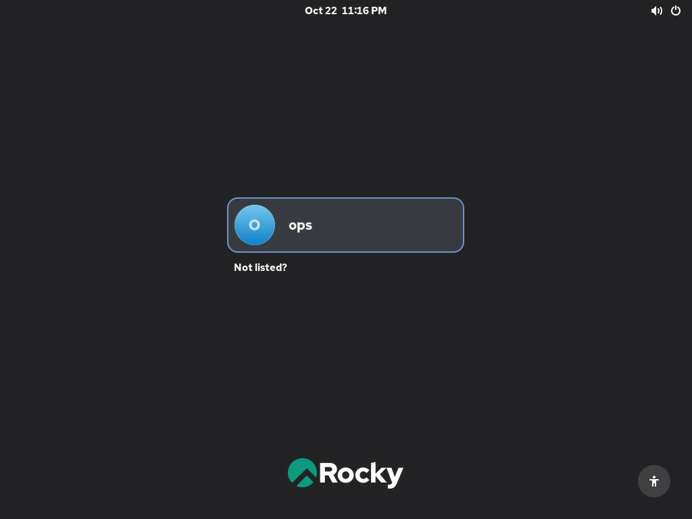
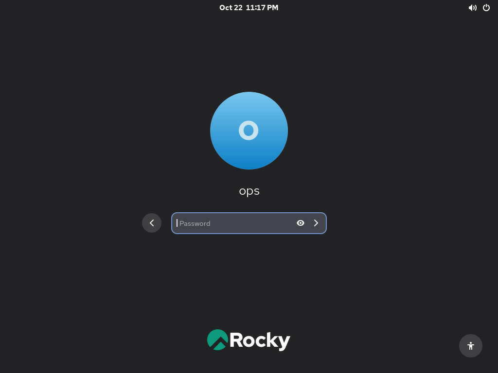
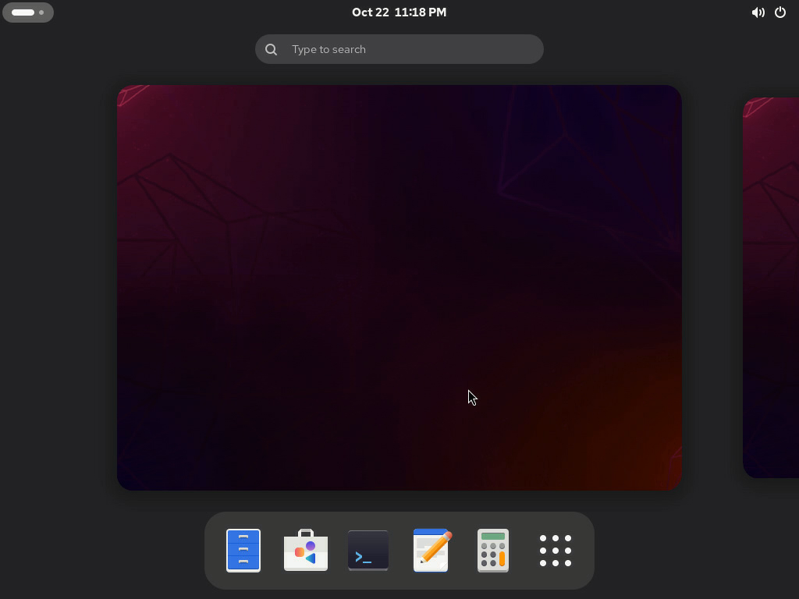
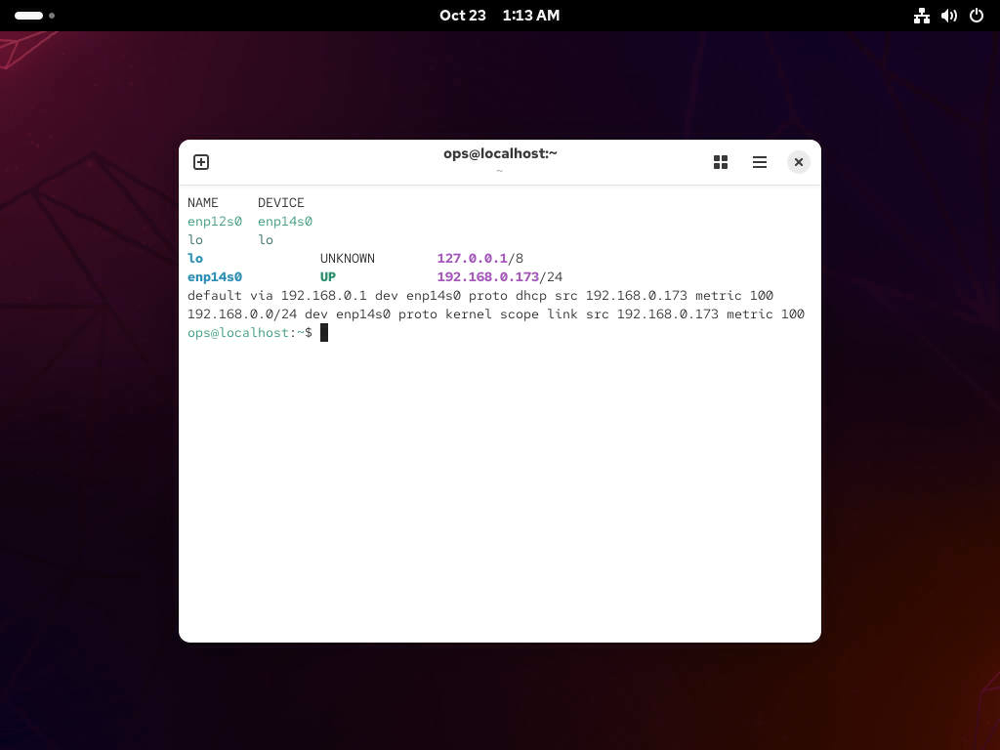

# asus-ipmi-mcp

Give your AI agent hands and eyes on a physical machine. This [MCP](https://modelcontextprotocol.io)
server connects to an **ASUS IPMI Expansion Card** and lets an agent (Claude Code, Cursor, Claude
Desktop, …) see the machine's screen, move the mouse, type, press keys, read sensors, control power
and update the card's firmware — exactly what you'd do in the card's web console, but as tools.
No browser, no Java, no VNC.

```
agent ──MCP (stdio)──> asus-ipmi-mcp ──HTTPS/WebSocket──> IPMI card (AST2600) ──USB keyboard/mouse + video──> host
```

> [!IMPORTANT]
> **Unofficial project.** asus-ipmi-mcp is an independent community project. It is **not affiliated
> with, endorsed by, or supported by ASUSTeK Computer Inc. or American Megatrends (AMI)**. "ASUS",
> "AMI" and "MegaRAC" are trademarks of their respective owners and are used only to describe
> compatible hardware. It talks to the card through the same interfaces its own web console uses,
> learned by observing them. Use at your own risk; for official support contact ASUS.

## What it's good for

- **Install or reinstall an OS without anyone at the machine:** watch the installer, click through it,
  type answers.
- **Fix machines that dropped off the network:** log in on the local console and repair the network,
  a service or a broken boot. The kind of problem that usually needs someone with a monitor and keyboard.
- **Change BIOS settings remotely:** reboot into setup, navigate menus, save.
- **Provision a fleet of on-prem boxes** step by step with an agent that can both see and act, for
  machines that have no PXE or automation set up yet.
- **Keep the IPMI card itself up to date:** check for and apply card firmware updates with built-in
  safety checks.

## See it in action

Everything below was done by an agent through this MCP server, on a headless ProArt X870E-CREATOR
WIFI running Rocky Linux, with no monitor attached.

| 1. `screenshot`: the agent sees the login screen | 2. `click` on the user: password prompt |
|---|---|
|  |  |
| **3. `type_text` the password: logged in** | **4. `press_keys` + `type_text` in a terminal: network repaired** |
|  |  |

The last one is a real repair: after the IPMI card was installed, the host's network cards got new
PCIe names and the old network profiles no longer matched, so the machine had no IP. The agent opened
a terminal over the KVM, found the mismatch with `nmcli`, rebound the profiles to the cards' MAC
addresses and brought the link up. No SSH was possible, because the machine had no network.

## What it can do

| Area | Capabilities |
|---|---|
| **See** | Screenshots of the host screen (full or cropped for small text), wait until the screen changes, wake a sleeping display |
| **Act** | Absolute mouse: click, double/right click, drag, scroll. Keyboard: type text, keys and combos (`f2`, `del`, `ctrl+alt+delete`, `super`, …) |
| **Know** | BMC firmware, host power state, sensors, KVM status (resolution, other viewers) |
| **Power** *(opt-in)* | On, off, graceful shutdown, restart; one-time boot device (CD, PXE, USB, BIOS setup) |
| **Virtual media** *(opt-in, experimental)* | Attach an ISO from an NFS/CIFS share as a virtual CD |
| **Card firmware** | Check for updates; download, verify and flash *(opt-in)* with dry run and confirmation token |

### Status

| Feature | State |
|---|---|
| Screen, mouse, keyboard, KVM status | ✅ tested on hardware |
| System info, sensors (read) | ✅ tested |
| Firmware check, prepare + dry run on the card | ✅ tested |
| Firmware flash via MCP | ⚠️ same API as a tested manual flash, but not yet run through MCP |
| Power control, boot override | ⚠️ implemented via Redfish, not yet tested on hardware |
| Virtual media | ⚠️ implemented from the web console's API, not yet tested |

Reports from other boards and firmware versions are very welcome. Please open an issue.

## Supported hardware

| | |
|---|---|
| Tested | ASUS IPMI Expansion Card-SI (90MC0AH0-MVUBY1), BMC firmware **1.3.13**, on a ProArt X870E-CREATOR WIFI |
| Should work | Other ASUS boards from the [compatible model list](https://dlcdnets.asus.com/pub/ASUS/mb/Add-on_card/IPMI_EXPANSION_CARD/Compatible_Model_List.pdf); likely other AMI MegaRAC BMCs with ASPEED AST2500/2600 and the H5Viewer (untested) |

## Install

Requires Node.js ≥ 22.19 on the machine running the agent, and network access to the card's management port.

Run straight from GitHub (replace `<owner>`):

```bash
npx -y github:<owner>/asus-ipmi-mcp
```

### Claude Code

```bash
claude mcp add asus-ipmi \
  -e ASUS_IPMI_HOST=192.168.0.144 -e ASUS_IPMI_USER=admin -e ASUS_IPMI_PASSWORD='…' \
  -- npx -y github:<owner>/asus-ipmi-mcp
```

### Generic MCP config (Claude Desktop, Cursor, …)

```json
{
  "mcpServers": {
    "asus-ipmi": {
      "command": "npx",
      "args": ["-y", "github:<owner>/asus-ipmi-mcp"],
      "env": {
        "ASUS_IPMI_HOST": "192.168.0.144",
        "ASUS_IPMI_USER": "admin",
        "ASUS_IPMI_PASSWORD": "…",
        "ASUS_IPMI_ALLOW_POWER": "0",
        "ASUS_IPMI_ALLOW_MEDIA": "0"
      }
    }
  }
}
```

For several machines, add one entry per card with different names.

### Configuration

| Variable | Default | Meaning |
|---|---|---|
| `ASUS_IPMI_HOST` | – (required) | Card IP / hostname |
| `ASUS_IPMI_USER` | `admin` | Card user (needs KVM privilege) |
| `ASUS_IPMI_PASSWORD` | – (required) | Card password |
| `ASUS_IPMI_ALLOW_POWER` | off | `1` enables `power` and `set_boot_once` |
| `ASUS_IPMI_ALLOW_MEDIA` | off | `1` enables `media_configure_share`, `media_mount`, … |
| `ASUS_IPMI_ALLOW_FIRMWARE` | off | `1` enables `firmware_prepare` and `firmware_flash` (card firmware update) |
| `ASUS_IPMI_SCREENSHOT_MAX` | `1024` | Long side of returned screenshots (pixels) |

## Tools

| Tool | What |
|---|---|
| `screenshot` | Current screen as an image (optional crop region for small text). Wakes a sleeping display. |
| `wait_for_screen_change` | Blocks until the screen changes (boot, install step), returns a screenshot |
| `click`, `move_mouse`, `drag`, `scroll` | Absolute mouse in screen pixels |
| `type_text` | Type text (US layout, `\n` = Enter) |
| `press_keys` | Keys / combos: `enter`, `f2`, `del`, `ctrl+alt+delete`, `ctrl+alt+f3`, `super`, with repeat |
| `kvm_status` | Resolution, display blank?, mouse mode, other KVM clients |
| `system_info` | BMC firmware, host power state, host BIOS/model |
| `sensors` | Temperatures, fans, voltages |
| `media_status` | Virtual-media settings and active redirections |
| `power` *(opt-in)* | `On`, `ForceOff`, `GracefulShutdown`, `ForceRestart` |
| `set_boot_once` *(opt-in)* | Next boot from `Cd`, `Pxe`, `Usb`, `Hdd`, `BiosSetup` |
| `media_configure_share`, `media_list_images`, `media_mount`, `media_unmount` *(opt-in)* | Attach an ISO from an NFS/CIFS share as virtual CD |
| `firmware_check_update` | Card firmware vs. releases on the ASUS support page (version, date, SHA-256) |
| `firmware_prepare` *(opt-in)* | Download + verify a card firmware (ASUS SHA-256, MD5, model match); `dry_run` lets the card verify it and cancels. Returns a `confirm_token` |
| `firmware_flash` *(opt-in)* | Flash the prepared image (needs the `confirm_token`), keeps settings, waits for the card to return |

### Card firmware update

Two steps on purpose: `firmware_prepare` (safe, can be a dry run on the card) then `firmware_flash`
with the returned token. What it protects against:

- wrong file: checks ASUS's published SHA-256, the MD5 inside the zip, and that the image is for the
  card's firmware model (e.g. `KOMMANDO`);
- getting stuck: once in flash mode the card refuses all other logins until reset. On any error
  before flashing starts, the server cancels flash mode itself and waits until the card accepts
  logins again; only if that fails does it tell you to power-cycle;
- interruption: the card has a single firmware slot. During `firmware_flash` (~10 min + reboot)
  never cut power to the host.

The update only touches the IPMI card, not the motherboard BIOS. The host keeps running.

Typical agent loop: `screenshot` → decide → `click` / `type_text` / `press_keys` → `wait_for_screen_change`.

## How it works

- Logs in to the card's web API, gets a KVM token, opens `wss://<card>/kvm` and speaks AMI's IVTP
  protocol (the same as the card's HTML5 viewer).
- Video is ASPEED's compressed format. It is decoded with **AMI's own decoder**, which this package
  does **not** ship: on first use it is downloaded from *your* card
  (`/libs/kvm/ast/decode_worker.js`) and cached in `~/.cache/asus-ipmi-mcp/` (per card + firmware).
- Keyboard and mouse are sent as USB HID reports through the same connection; the card presents
  itself to the host as a USB keyboard and absolute mouse.
- Power, sensors and boot override use the card's Redfish API.

## Things to know

- **One controlling KVM session per card.** Using the tools takes control from an open browser
  viewer (the viewer gets a "Permission Requested" prompt and loses control after ~30 s).
- **Black screen / "no signal"** usually means the host display is asleep. `screenshot` nudges the
  mouse to wake it. For unattended work, disable screen blanking on the host.
- **No monitor needed** on the host: the card provides the display. A monitor attached to the board's
  own outputs may take the picture away from the card.
- **US keyboard layout** is assumed. On hosts with another layout, symbols and some letters differ.
- **Sensors empty / host BIOS unknown**: ASUS desktop/workstation boards need a special IPMI-enabled
  BIOS from ASUS support for full sensor integration. KVM, keyboard, mouse and power state work without it.
- **Power-button pass-through**: on a ProArt X870E without the special BIOS, wiring the chassis
  power/reset buttons through the card made the board hang at the DRAM Q-LED. Wire them directly to the board.
- The card's self-signed certificate is accepted (no TLS verification).

## Safety

This server can type passwords, power-cycle machines, boot installers and flash firmware. Keep
`ASUS_IPMI_ALLOW_POWER`, `ASUS_IPMI_ALLOW_MEDIA` and `ASUS_IPMI_ALLOW_FIRMWARE` off unless needed, use a dedicated card user, put the card on a management
network, and review what the agent does — it's physical access over the network.

## Development

```bash
npm install
ASUS_IPMI_HOST=… ASUS_IPMI_PASSWORD=… npm run smoke     # read-only tools + one screenshot
```

Protocol notes are in the source headers (`src/kvm.js`, `src/media.js`).

Manual hardware tests in `test/` (they act on a real card and host – read them before running):
`smoke.js` (read-only + screenshot), `unlock.js` (types a password on the host),
`firmware-dryrun.js` (uploads firmware to the card and cancels; the card restarts).

## License and disclaimer

MIT for this code. The video decoder is AMI property and is not included; it is fetched from your own
device at runtime.

This project is not affiliated with ASUSTeK Computer Inc. or American Megatrends. It can control
power, type into and flash firmware on real hardware; you are responsible for how you use it.
Flashing firmware always carries a risk of making the card unusable.
